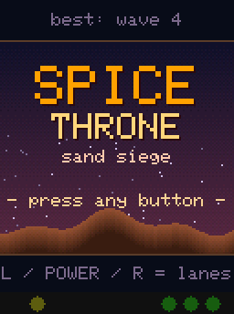
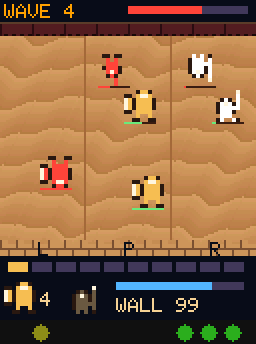
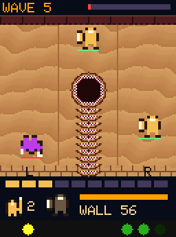
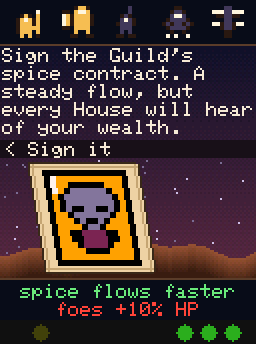
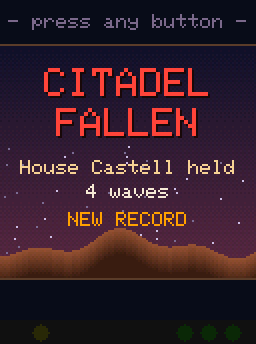

# SPICE THRONE — Sand Siege

A fast three-lane siege game for the **Meteor Dodge breadboard**: an Arduino UNO with a 1.8" SPI TFT, three buttons, one yellow LED and three green LEDs. No rewiring is needed.

| Title | Siege | Worm | Petition | Defeat |
|---|---|---|---|---|
|  |  |  |  |  |

*Screenshots from the desktop simulator, shown at 2× scale. The strip under each screen shows the LEDs: yellow on the left, the three green LEDs on the right.*

**The three buttons are the three lanes.** House Vulkar's troops pour out of the gate at the top and march down three lanes toward your wall.

- **Deploy:** tap LEFT, POWER or RIGHT to send the unit in your hand down that lane. Your hand shows the current unit and the next one, drawn from your deck, and each unit costs spice. Spice refills on its own.
- **Fight:** units fight on their own and counter each other.
  - Troopers shrug off blades.
  - Riflemen shoot down thopters.
  - Sandriders run riflemen down.
  - Thopters fly over the melee.
- **Raid:** a unit that reaches the enemy gate raids it, which gives you spice and leaves fewer enemies in the wave.
- **Worm:** when the worm is awake (the yellow LED blinks), **hold** a lane's button. A sandworm surfaces and swallows *everything* on the ground in that lane, your own troops included. Thopters are safe.
- **Petitions:** after every wave you hold, a petitioner brings a Reigns-style bargain. Lean the card left or right to see exactly what it does, then press the same side again (or POWER) to accept. Choices can unlock riflemen, sandriders and thopters, sharpen or armour a unit, make units cheaper, speed up spice, or repair and raise the wall. The best offers usually cost wall HP or make Vulkar's troops tougher.

Every fifth wave, Vulkar sends his champion. The run ends when the wall falls, and the best wave held is saved in EEPROM.

The two earlier versions are kept as complete, uploadable sketches:
- `legacy/spice_throne_v1/` is the Reigns-only dynasty game.
- `legacy/spice_throne_v2/` is the Travian-style strategy game with economy, map and autobattles.

## Hardware (same wiring as Meteor Dodge)

| Part | Pin |
|---|---|
| TFT CS / DC / RST | D10 / D9 / D8 |
| TFT SDA / SCK | D11 / D13 (hardware SPI, 8 MHz) |
| LEFT button | D2 (wired to GND, internal pull-up) |
| POWER button | D12 |
| RIGHT button | A0 |
| Yellow LED | D4 (software PWM on Timer2) |
| Green LEDs | D3, D5, D6 (hardware PWM) |

The display runs in portrait (128×160), in the same orientation as the original game's text screens.

| LED | Meaning |
|---|---|
| Green | The wall, in thirds; the last LED pulses when the wall is about to fall |
| Yellow | Worm charge (brightness); blinks when the worm is ready |

## Build and upload

**Arduino IDE:** open `spice_throne/spice_throne.ino`, select *Arduino Uno*, then Upload.

**arduino-cli:**

```
arduino-cli compile --fqbn arduino:avr:uno spice_throne
arduino-cli upload  --fqbn arduino:avr:uno -p COM3 spice_throne
```

The firmware is bare-metal C. `main()` is in `main.c`, and the Arduino core's `setup()`, `loop()` and timer0 `millis()` are not used. It uses about 19.4 KB of the 32,256 bytes of flash and 0.8 KB of the 2 KB of RAM. Battle frames are paced at 40 ms (25 fps). On the board, a frame with a handful of units renders in 2–5 ms, about 1 ms per unit, so a full field of 28 units still fits in the frame.

For serial telemetry, build with `-DSPICE_TRACE`. Each line printed at 115200 baud is `<ms> <event> <value>`, and events include the battle frame time. A trace build also starts a run by itself after 8 s, so it can be measured without anyone pressing a button.

```
arduino-cli compile --fqbn arduino:avr:uno --build-property "compiler.c.extra_flags=-DSPICE_TRACE" spice_throne
```

### Why C and not Rust

Both can target the ATmega328P, but C was chosen for two reasons:

- **Size and speed:** avr-gcc with link-time optimisation produces smaller, faster code for this chip than Rust's LLVM AVR backend. Flash was the hard limit for the earlier versions.
- **Same setup:** the sketch builds in the same stock Arduino IDE that Meteor Dodge used. Rust would need a nightly toolchain and `avr-hal`.

## Units

| Unit | Spice | Role |
|---|---|---|
| Levy | 2 | Cheap, quick spear; fills a lane |
| Trooper | 4 | Slow and armoured; takes 30% less damage from melee |
| Rifleman | 3 | Long-range fire; double damage against thopters |
| Sandrider | 5 | Fast and hard-hitting; +50% against riflemen |
| Thopter | 6 | Flies, so melee can't touch it; ranged; safe from the worm |

You start with levies and troopers; the others come from petitions. Waves grow by 4 spice-worth of troops each time. Enemies gain 6% HP per wave, plus 10% for every *harder* bargain you accept. Riflemen appear from wave 3, sandriders from wave 5 and thopters from wave 7.

## Project layout

```
spice_throne/           firmware (Arduino sketch folder)
  main.c                entry point
  run.c                 run state, rng, lane input (tap/hold), printf-lite, top loop
  field.c               the siege: lanes, units, combat, spawning, worm, HUD, LEDs
  perks.c               petition cards (lean/swipe), bargains and their effects
  title.c               title and end screens, best wave in EEPROM
  hal_avr.c hal.h       timers, debounced buttons, LED PWM, EEPROM
  lcd_st7735.c lcd.h    ST7735 driver (the Arduino TFT library's init sequence)
  gfx.c gfx.h           shaders, dithered gradients, 5x7 font, word wrap
  leds.c                LED animations (breathe, pulse, blink, flicker)
  text.c                decoder for byte-pair-encoded text
  assets_gen.[ch]       GENERATED: petitions, text, portraits, unit sprites
tools/
  content/perks.py      the petition deck (pure data + self-check)
  content/art.py        palette, portraits, unit sprites (pure data + self-check)
  gen_assets.py         turns the content files into assets_gen.[ch]
  sim/                  desktop simulator
legacy/                 the two earlier games, each a complete sketch
```

### Editing content

```
python tools/content/perks.py      # validate the deck
python tools/content/art.py        # validate the art
python tools/gen_assets.py         # regenerate spice_throne/assets_gen.[ch]
```

### Desktop simulator

The simulator compiles the real game sources against a virtual screen, clock, EEPROM and buttons. It needs gcc or clang, plus Pillow for screenshots.

```
python tools/sim/run.py shots "PwLsPsRss1ss"   # scripted keys -> PNG frames + contact sheet
python tools/sim/run.py soak 300 7             # 5 virtual hours of button mashing
python tools/sim/run.py stats 200 1            # a simple bot plays 200 runs
```

**Script keys:** `L` `P` `R` tap a lane, `1` `2` `3` hold a lane, and `s` `w` `W` wait 1, 5 or 60 seconds. The strip under each screenshot shows the four LEDs.

**Soak** fails on any out-of-bounds draw or broken invariant.

**Stats** prints the average and best wave the bot held, plus a histogram. The bot always sends its unit to the most threatened lane and picks bargains at random, so treat its numbers as a floor for balance work, not as a measure of difficulty.
